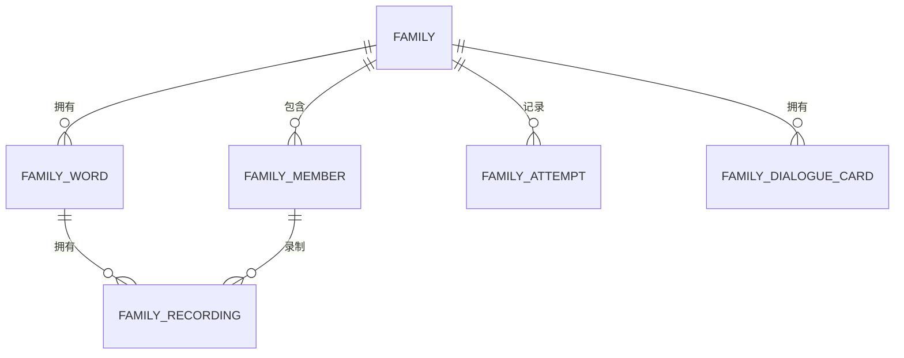
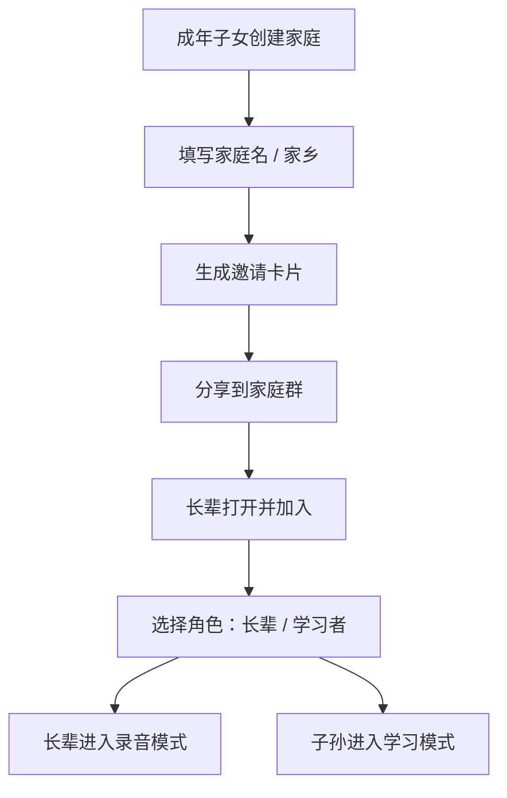
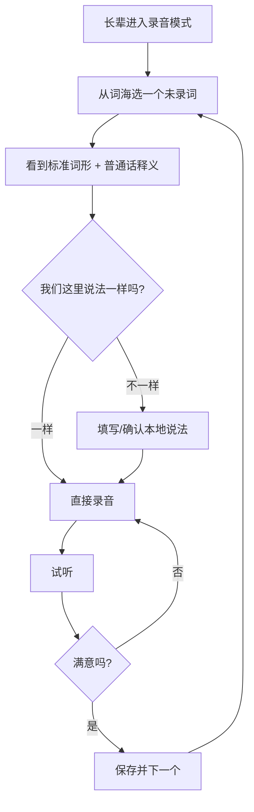
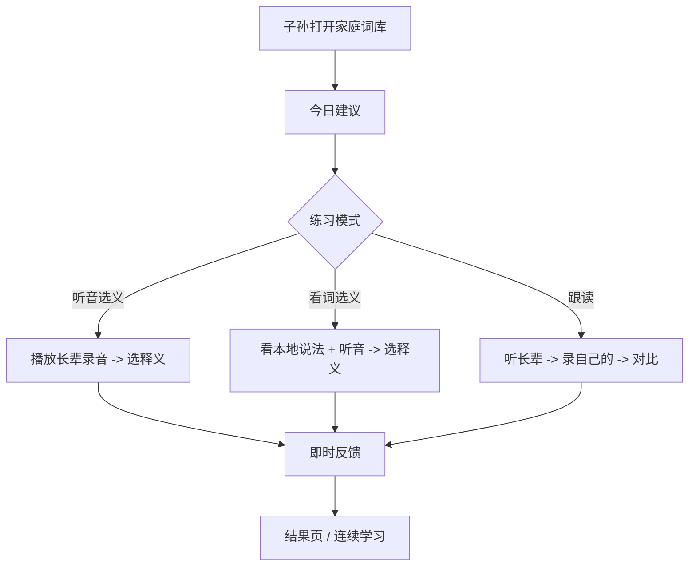

# 家庭口音词库模块（长辈教学）· 产品设计

| 项目 | 内容 |
| --- | --- |
| 模块名 | 家庭口音词库 / 长辈教学 |
| 文档版本 | v0.1 Draft |
| 更新日期 | 2026-11-27 |
| 关联文档 | [PRD](./PRD.md) |
| 状态 | 本地录音原型已实现；云端家庭版待开发 |

> 本地原型：家庭主页、长辈录音、家庭词库、听音选义已可在真机体验；数据仅存本机，未接云端。

---

## 1. 一句话

**让每个家庭用自己的口音，建一座只属于家人的方言词库：长辈录，子孙学。**

不是再做一个「标准粤语课」，而是让爷爷、奶奶、外公、外婆把自家城镇的说法和发音留下来，后辈在每日练习和家庭对话里慢慢学会。

---

## 2. 为什么值得做

### 2.1 口音是「一家一个样」的

同一个县、相邻两个镇，同一个词的说法和声调都可能不同。通用方言 App 只能用一套标准音，覆盖不了这种差异，也解释不了「你爷爷是这么说的」。

### 2.2 长辈是最好的内容源

- 长辈有大量时间，也最愿意把话留给后辈。
- 他们不需要会写字、会拼音，只需要会说话。
- 一个家庭录 100 个词，只需要 30–60 分钟；对长辈是轻松的日常任务。

### 2.3 子孙需要的是「听得懂家里的话」

不是考试，也不是标准音。是过年回家能听懂爷爷说什么、能接一句。家庭词库比通用词库更有情感和场景价值。

### 2.4 对产品来说，这是内容护城河

- 平台不需要自己录遍每个村的口音，家庭自己生产内容。
- 每个家庭的词库都是私有的、不可复制的。
- 未来如果家庭愿意，可以自愿汇成「家乡口音地图」（P2），形成公共价值。

---

## 3. 产品定位与边界

### 3.1 定位

**家庭私有的方言传承工具：长辈按自家口音录词，子孙用长辈的录音每天学几个。**

### 3.2 第一版边界

- 家庭私有：默认只有家庭成员可见，不做公开社区。
- 音频优先：长辈录音是核心内容；文字只做辅助。
- 低门槛：长辈模式一屏一词、大按钮、录音/试听/重录/下一个。
- 不做实时聊天、不做公开评论、不做 AI 方言对话。
- 「对话」第一版是**脚本化的家庭对话卡 + 跟读**，不是自由聊天。

### 3.3 与现有产品的关系

现有「每日看词选义」是学习引擎；家庭模块复用这套引擎，但把音频和词条换成**长辈自己的录音与本地说法**。两者不是二选一：

- 没有家庭词库时：用户学内置粤语词书。
- 加入家庭后：每日练习优先使用家庭词库的音频。
- 家庭词库可以包含内置词海的词，也可以有家人补充的本地词条。

---

## 4. 用户与角色

| 角色 | 画像 | 核心诉求 | 产品里的动作 |
| --- | --- | --- | --- |
| 家庭管理员（成年子女） | 25–45 岁，发起者，熟悉手机 | 把长辈的口音留下来，让孩子能学 | 建家庭、邀请长辈、补充词条、管理成员 |
| 长辈（录音者） | 55–80 岁，方言母语者，操作手机不熟练 | 把家里的说法留给后辈 | 选词、录音、试听、重录、下一个 |
| 学习者（子孙） | 6–12 岁儿童或成年后辈 | 听懂、会说家里的方言 | 每日练习、听音选义、跟读、家庭对话 |
| 旁听成员（可选） | 其他亲戚 | 听听、看看，不参与录音 | 只读访问 |

**账号主体**：仍然以微信 openid 为单位。儿童使用家长微信；不采集儿童身份信息。长辈尽量用自己的微信加入；如果长辈没有微信，允许管理员用「代录模式」在自己的手机上录长辈的声音，但需要明确授权与隐私说明（P1）。

---

## 5. 核心概念与数据模型

### 5.1 概念层级

```
家庭 Family（我们家的粤语）
  ├── 成员 FamilyMember（管理员 / 长辈 / 学习者）
  ├── 家庭词库 FamilyWordBook（复用内置词海 + 本地补充）
  │     └── 家庭词条 FamilyWord
  │           ├── 标准词形 / 标准释义（来自内置词海）
  │           ├── 本地说法 / 本地注音（长辈可改）
  │           └── 录音 Recording（一个词可以有多条，爷爷版 / 奶奶版）
  ├── 练习记录 FamilyAttempt
  └── 家庭对话卡 FamilyDialogueCard（P1）
```

### 5.2 集合设计（云开发）

| 集合 | 说明 | 关键字段 |
| --- | --- | --- |
| `families` | 家庭 | `name`、`hometown`、`region`、`ownerOpenid`、`inviteCode`、`privacy`、`createdAt` |
| `family_members` | 家庭成员 | `familyId`、`openid`、`role`、`relation`、`nickname`、`status`、`joinedAt` |
| `family_words` | 家庭词条 | `familyId`、`baseWordId`、`standardTerm`、`standardMeaning`、`localTerm`、`localReading`、`status`、`createdBy` |
| `family_recordings` | 长辈录音 | `familyId`、`familyWordId`、`fileId`、`duration`、`recordedBy`、`status`、`quality`、`createdAt` |
| `family_attempts` | 学习记录 | `familyId`、`openid`、`familyWordId`、`mode`、`correct`、`listened`、`createdAt` |
| `family_word_requests` | 子孙请求补充的词 | `familyId`、`term`、`meaning`、`requestedBy`、`status` |
| `family_dialogue_cards` | 家庭对话卡（P1） | `familyId`、`title`、`scene`、`lines[]`、`status` |
| `family_invites` | 邀请 | `familyId`、`token`、`createdBy`、`expiresAt`、`maxUses` |

### 5.3 关键设计

- **标准词与本地说法分离**：内置词海提供标准词形和普通话释义；长辈可以说「我们这里叫 X」，录成 `localTerm` + 本地发音。学习页展示本地说法，释义仍用普通话。
- **一个词可以有多条录音**：爷爷、奶奶、外公可以各录一版；学习者可以选择「听谁的」。
- **录音默认私有**：只对家庭成员可见；公开分享必须单独授权 + 审核（P2）。
- **录音有版本**：重录不覆盖旧版，保留最近一次可用版本；家庭管理员可以回滚。
- **词条状态**：`draft`（未录/待审）→ `recorded`（已录）→ `published`（家庭成员可学）。

### 5.4 实体关系



---

## 6. 核心流程

### 6.1 建家庭与邀请



### 6.2 长辈录词



### 6.3 子孙学习



### 6.4 家庭对话卡（P1）

- 先做 3–5 个固定场景：吃饭、买菜、打招呼、过年、问路。
- 每个场景 4–8 句，由长辈逐句录音。
- 学习者选一个角色，逐句听、跟读、录音；不要求 AI 评分，先做「听—说—保存」。
- 长辈可以在家庭里听子孙的跟读，给一个「👍 / 再练一次」的轻反馈，不做自由聊天。

---

## 7. 功能范围

### 7.1 P0（家庭模块 MVP）

| 功能 | 说明 |
| --- | --- |
| 微信登录 + 云端 | 家庭、成员、词库、录音、学习记录持久化 |
| 创建 / 加入家庭 | 邀请卡片 / 二维码；角色：管理员、长辈、学习者 |
| 内置词海 | 复用现有粤语入门词书 100–200 词，含标准词形、释义、粤拼（可选） |
| 长辈录音模式 | 一屏一词；录音、试听、重录、保存、下一个；可不填文字 |
| 本地说法 | 长辈可把标准词改成「我们这里叫 X」；释义仍用普通话 |
| 家庭词库发布 | 录完的词进入家庭词库，子孙可学 |
| 子孙每日练习 | 复用看词选义引擎，题干/音频换成家庭词条；优先「听音选义」 |
| 家庭主页 | 家庭成员、录音进度、已学词数、今日建议 |
| 隐私与删除 | 默认家庭私有；长辈可删除自己的录音；家庭可整体删除 |
| 权限 | 所有家庭数据经云函数校验成员身份；存储不公开 |

### 7.2 P1

| 功能 | 说明 |
| --- | --- |
| 跟读录音 | 学习者录自己的发音，与长辈录音对比试听；不评分 |
| 长辈轻反馈 | 长辈听子孙跟读，给「👍 / 再练一次」，不做聊天 |
| 家庭对话卡 | 固定场景、逐句长辈录音、学习者角色扮演 |
| 词条请求 | 子孙提交想学的词，长辈录 |
| 多版本录音 | 一个词多条录音，选择「爷爷版 / 奶奶版」 |
| 成员管理 | 邀请审批、角色调整、移除成员 |
| 导出 / 备份 | 导出家庭词库和音频（P1） |
| 录音提醒 | 订阅消息提醒长辈今天录几个 |

### 7.3 P2

- 家庭自愿公开词库，汇成「家乡口音地图」。
- 跨家庭交换 / 方言社区（需要审核与内容安全）。
- 语音相似度对比 / AI 辅助纠音（方言 ASR 不成熟，先不做评分）。
- 家庭会员 / 扩容存储。
- 离线音频包。

### 7.4 明确不做

- 自由聊天 / 家庭动态流 / 评论。
- 实时语音通话。
- AI 方言对话或口语评分。
- 未审核的公开 UGC。

---

## 8. 页面与交互

### 8.1 家庭主页

```
┌─────────────────────────────┐
│ 我们家的粤语          ⚙️     │
│ 广东 · 台山                  │
│                             │
│ 爷爷已录 42 词               │
│ ████████░░░░  42 / 100       │
│                             │
│ [ 长辈录音 ]  [ 开始学习 ]    │
│                             │
│ 家庭成员：爷爷、妈妈、小粤     │
│ 今日：小粤已学 3 个词         │
└─────────────────────────────┘
```

### 8.2 长辈录音模式

```
┌─────────────────────────────┐
│ ← 录音模式            12/100 │
│                             │
│         食饭                 │
│         吃饭                 │
│                             │
│   ┌─────────────────────┐   │
│   │   ● 按一下开始录音   │   │
│   └─────────────────────┘   │
│                             │
│   我们这里叫：____________    │
│                             │
│   已录 3 秒  [试听] [重录]   │
│                             │
│        [ 保存，下一个 ]       │
└─────────────────────────────┘
```

**交互要点**

- 一屏一个词，字大、按钮大、没有小字。
- 录音按钮只有一个，状态清晰：未录 / 录音中 / 已录。
- 自动显示「已录 3 秒」，避免长辈不知道录没录上。
- 支持「跳过」；不强制一次录完。
- 不要求长辈打字；本地说法可以跳过，或由管理员后补。
- 录音完成自动试听一次，长辈确认后再保存。

### 8.3 子孙学习

- 优先「听音选义」：播放长辈录音，四选一选普通话释义。
- 其次「看词选义」：显示本地说法 + 注音，播放录音，选释义。
- 结果页显示「今天学会 3 个爷爷教的词」。
- 跟读页：播放长辈录音 → 录自己的 → 并排试听；不评分。

### 8.4 家庭对话卡（P1）

```
场景：食饭
爷爷：食饭啦。
你：   来啦。
爷爷：今日有鱼。
你：   好味。
[听整段] [逐句听] [录我的部分]
```

---

## 9. 录音与音频规范

| 项目 | 建议 |
| --- | --- |
| 录音 API | `wx.getRecorderManager()` |
| 格式 | MP3 或 AAC；优先 MP3，兼容性好 |
| 采样率 | 16kHz 或 24kHz，单声道 |
| 时长 | 单词 1–5 秒；例句 3–15 秒；上限 30 秒 |
| 文件大小 | 100 词约 1–2MB / 家庭（压缩后） |
| 命名 | `families/{familyId}/words/{familyWordId}/{recordingId}.mp3` |
| 质量 | 安静环境、手机离嘴 10–20cm、自然语速；录音后自动试听 |
| 重录 | 不覆盖旧版，保留最近可用版本；可回滚 |
| 音量 | 可选服务端响度归一化；P1 |
| 质检 | 时长异常、音量过低/爆音标记；P1 可加简单检测 |
| 播放 | `wx.createInnerAudioContext`；本地缓存；同一时间只播一条 |

**权限**：首次录音请求 `scope.record`；拒绝后引导去设置页开启；长辈模式提供图文/语音提示。

---

## 10. 技术方案

### 10.1 云端

- 继续用微信云开发：云数据库 + 云函数 + 云存储。
- 所有家庭数据的读写都走云函数，校验 `openid` 与 `family_members.role`。
- 云存储文件不直接公开；通过云函数校验成员身份后返回临时 URL，或使用云存储权限策略。
- 邀请 token 设置有效期与使用次数；加入时校验 token + 家庭状态。

### 10.2 云函数（建议）

| 云函数 | 职责 |
| --- | --- |
| `createFamily` | 创建家庭、生成邀请码、写入 owner 成员 |
| `joinFamily` | 校验邀请 token、加入成员、设置角色 |
| `getFamilyHome` | 家庭主页、成员、录音进度、今日建议 |
| `listFamilyWords` | 家庭词库 / 待录词列表 |
| `saveFamilyWord` | 保存本地说法、释义、状态 |
| `saveRecording` | 保存录音元数据、绑定文件、更新词条状态 |
| `publishFamilyBook` | 发布家庭词库 |
| `getFamilyPractice` | 生成家庭词库练习（音频 + 选项） |
| `submitFamilyAttempt` | 记录学习、更新 SRS |
| `saveDialogueCard` | 保存对话卡（P1） |
| `deleteFamily` / `deleteRecording` | 删除家庭 / 录音，级联清理 |

### 10.3 权限模型

- `owner`：管理成员、删除家庭、发布词库。
- `elder`：录音、编辑自己录的词、查看家庭进度。
- `learner`：学习、跟读、请求词条；不能改词库。
- 所有云函数先查 `family_members`，再执行操作；不信任客户端传入的 familyId。
- 家庭删除：级联删除词条、录音、学习记录、对话卡；云存储文件异步清理。

### 10.4 录音上传

```
wx.getRecorderManager() -> 临时文件
  -> wx.cloud.uploadFile({ cloudPath, filePath })
  -> 云函数 saveRecording({ familyId, wordId, fileId, duration })
  -> 更新 family_words.status = recorded
```

- 上传失败可重试；本地保留临时文件直到成功。
- 大文件（对话卡整段）可分段或后台上传（P1）。

---

## 11. 隐私、合规与内容安全

| 事项 | 要求 |
| --- | --- |
| 家庭私有 | 默认仅家庭成员可见；不公开搜索、不进入推荐 |
| 长辈授权 | 录音前明确告知用途、可见范围、删除方式；需主动同意 |
| 声音属于个人信息 | 允许长辈删除自己的录音；家庭删除时级联清理 |
| 儿童保护 | 学习者不采集身份信息、无公开主页、无评论；账号主体为家长 |
| 公开分享 | P2 才做；必须单独授权 + 内容审核 + 可撤回 |
| 内容安全 | 家庭词条文本过 `msgSecCheck`；公开内容人工审核；音频公开前抽检 |
| 数据出境 | 使用微信云开发，数据在境内；隐私政策说明存储与期限 |
| 版权 | 长辈录音归长辈/家庭所有；平台仅在家庭内提供存储与播放；公开需授权 |
| 注销/删除 | 家庭可整体删除；成员可退出并删除自己的录音 |

**原则**：先做「家庭私有」，不做公开社区；先把信任建立起来，再谈共享。

---

## 12. 指标

| 指标 | 定义 |
| --- | --- |
| 家庭激活 | 创建家庭 → 邀请长辈 → 完成第 1 条录音 |
| 长辈录音完成率 | 已录音词数 / 词库词数 |
| 长辈周活跃 | 一周内至少录 1 条的长辈数 |
| 家庭学习活跃 | 一周内至少完成 1 次家庭词库练习的学习者数 |
| 听音播放率 | 播放过家庭录音的学习者 / 家庭学习者 |
| 7 日家庭留存 | 创建后第 7 天仍有录音或学习行为的家庭 |
| 词库厚度 | 每个家庭已发布词条数 |
| 跟读率（P1） | 完成跟读录音的学习者 / 练习学习者 |

**MVP 目标（建议）**：内测 5–10 个家庭；长辈首周录 20 词；学习者每周 2–3 次练习；家庭 7 日留存 ≥ 50%。

---

## 13. 风险与对策

| 风险 | 影响 | 对策 |
| --- | --- | --- |
| 长辈不会用 | 录音启动失败 | 长辈模式、一屏一词、大按钮、家人协助首次设置、3 步引导 |
| 录音质量差 | 学习体验差 | 录音后试听、重录、环境提示；P1 音量检测 |
| 长辈没有微信 | 无法加入 | 允许管理员「代录模式」，明确授权；P1 |
| 隐私顾虑 | 不敢录 | 默认家庭私有、可删除、可退出、公开需单独授权 |
| 词海不匹配 | 本地说法不同 | 本地说法字段、子孙请求词条、管理员补充 |
| 内容审核 | 公开后风险 | P2 才公开；文本过安全接口；音频人工抽检 |
| 存储成本 | 家庭多了成本上升 | 压缩音频、单家庭上限、P2 会员扩容 |
| 范围膨胀 | 做成聊天/社交 | v1 明确不做自由聊天、评论、AI 对话 |
| 冷启动 | 没人发起 | 从「成年子女给长辈建词库」切入；家庭群分享 |

---

## 14. 里程碑

| 阶段 | 内容 |
| --- | --- |
| F0 设计确认 | 本文件评审；确定私有/公开、对话范围、词海规模 |
| F1 云端与账号 | 微信登录、云开发、家庭/成员/邀请 |
| F2 长辈录音 MVP | 选词、录音、试听、重录、保存、家庭词库 |
| F3 子孙学习 MVP | 家庭词库每日练习、听音选义、结果与统计 |
| F4 内测 | 5–10 个家庭，观察长辈录音完成率与子孙回访 |
| F5 P1 | 跟读、长辈轻反馈、对话卡、词条请求 |

---

## 15. 开放问题

| # | 问题 | 建议 | 截止 |
| --- | --- | --- | --- |
| 1 | 家庭词库默认私有还是可公开？ | 默认私有；公开 P2 且需单独授权 | F0 |
| 2 | 谁发起家庭？ | 成年子女发起、邀请长辈；也允许长辈自己建 | F0 |
| 3 | 词海多大？ | 先 100–200 个日常高频词，避免长辈一开始就压力大 | F0 |
| 4 | 本地说法怎么录？ | 标准词 + 「我们这里叫 X」；文字可由管理员后补 | F0 |
| 5 | 对话第一版做到哪？ | 固定场景对话卡 + 跟读，不做自由聊天/AI | F0 |
| 6 | 跟读要不要评分？ | 不评分；先做「听—说—保存—长辈轻反馈」 | F0 |
| 7 | 一个词多条录音？ | P1；MVP 先一条，保留扩展字段 | F1 |
| 8 | 长辈没有微信怎么办？ | P1 代录模式；MVP 先要求长辈自己的微信 | F1 |
| 9 | 家庭人数上限？ | 先 10 人；后续按需调整 | F1 |
| 10 | 是否支持其他方言？ | 数据模型语言无关；首发仍粤语 | F2 |

---

## 16. 与现有 PRD 的关系

- 本模块复用现有「看词选义」练习引擎、SRS、结果页、统计和低压力原则。
- 新增的是：家庭空间、成员角色、长辈录音、家庭词库、家庭练习音频。
- 现有本地 Demo 不接云端，因此家庭模块放到云端阶段实现；Demo 可先做「长辈录音」交互原型（本地录音、试听、重录、保存）验证手感。
- 产品叙事可以从「每天学几个粤语词」升级为「把家里的口音留下来」；日常练习仍是入口，家庭词库是留存和差异化的核心。

---

## 变更记录

| 版本 | 日期 | 变更 |
| --- | --- | --- |
| v0.1 | 2026-11-27 | 初稿：家庭口音词库、长辈录音、子孙学习、对话卡与隐私边界 |
