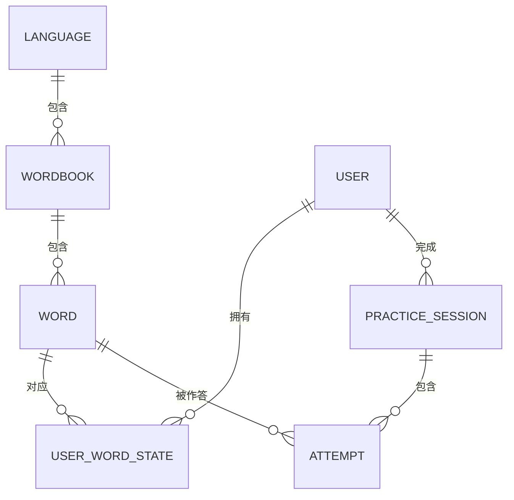
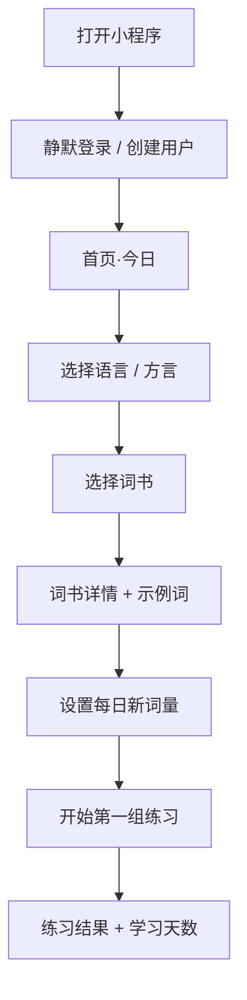
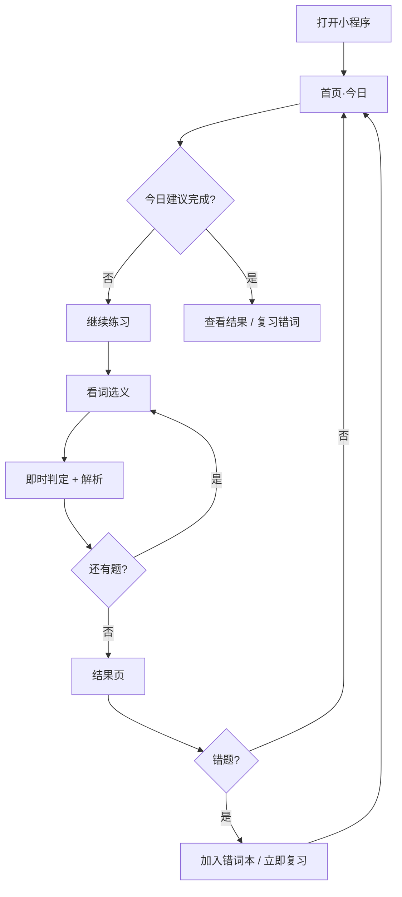
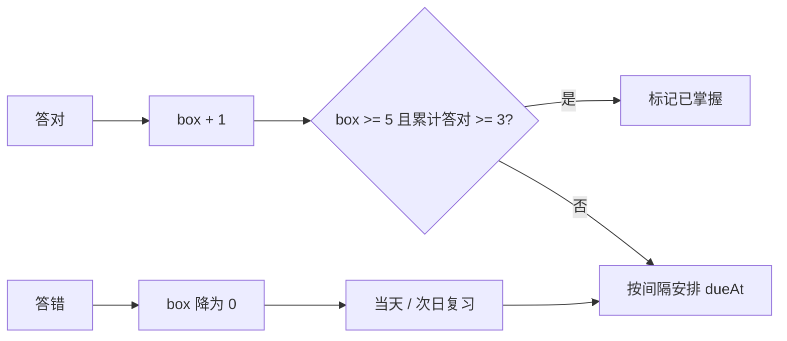
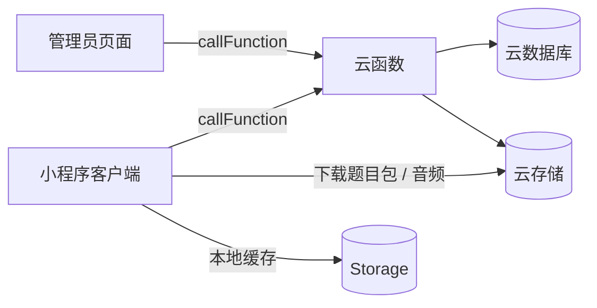

# 每日单词练习小程序 · 产品需求文档（PRD）

| 项目 | 内容 |
| --- | --- |
| 工作名 | Daily Vocabulary（产品名待定） |
| 文档版本 | v0.6（Draft） |
| 更新日期 | 2026-11-27 |
| 本地测试词表 | 普通话 40 词，家人称呼 → 日常场景 → 基础词汇（正式首发语言 / 方言待定） |
| 第二阶段 | 家庭口音词库（长辈教学），见 `docs/FAMILY-MODULE.md` |
| 产品负责人 | lowkey |
| 状态 | 待评审 |
| 载体 | 微信小程序（面向公众发布） |

> 内容方向说明：本地测试词表先用普通话，验证通用学习与长辈录音流程；正式首发语言 / 方言待定，粤语仍是候选之一，不再作为唯一首发。

---

## 0. 一页纸摘要

**一句话**：一个轻量的词汇练习微信小程序——每天 3–5 分钟，用「看词选义」学几个词，学多学少都算数。当前本地测试词表用普通话；第二阶段加入「家庭口音词库」：长辈按自家口音录词，子孙用长辈的录音学习。

**要解决的问题**

1. 想接触方言 / 语言的人（包括家长和小朋友）缺少低门槛、低压力的碎片化练习工具。
2. 现有背单词产品几乎围绕英语设计，词书和题型不适配方言的书写、注音与发音。
3. 方言内容零散在短视频和词典里，缺少「打开就能学几个」的每日闭环。

**目标用户**

- 碎片时间自学者：想利用通勤、排队、睡前几分钟接触方言 / 语言的成年人（包括家长本人）。
- 小朋友：6–12 岁，在家长陪伴下使用，界面适龄、无压力。
- 家长：账号主体与陪伴者（小程序运行在家长微信中）。
- 次要用户：对方言 / 语言文化感兴趣的成年人、方言内容爱好者。

**第一版（MVP）范围**

- 微信小程序，静默登录，数据云端持久化。
- 本地测试：普通话 40 词，按「家人称呼 → 日常场景 → 基础词汇」三阶段组织；正式首发语言 / 词书待定（正式词书建议 200–300 词）。
- 每日建议：3–5 个新词 + 到期复习，单组上限 10 题；学 1 个词也记录为学习。
- 「看词选义」练习，题干 / 选项方向可按词书配置。
- 单词发音：第三方 TTS 预生成标准词书音频，练习页可点读。
- 练习结果、连续学习天数、错词本、基础统计。
- 内容导入与发布：JSON + 本地脚本批量导入，TTS 音频生成；小程序内管理界面 P1。

**第二阶段核心模块：家庭口音词库（长辈教学）**

- 家庭私有空间：长辈按自家城镇口音录词，子孙用长辈的录音学习。
- 内置词海 + 本地说法 + 长辈录音；支持听音选义、跟读与家庭对话卡。
- 默认仅家庭可见，不做公开 UGC；不做自由聊天 / AI 方言对话。
- 详细设计：[docs/FAMILY-MODULE.md](./FAMILY-MODULE.md)

**第一版不做**

社交 / 评论 / 排行榜、公开用户投稿（UGC）、付费、听音辨词、拼写题、口语评测、多孩账号、家长独立端、真人录音。家庭模块与长辈录音放到第二阶段。

**最大风险**

1. 小程序备案与主体 / 类目资质，直接决定能否按时上架。
2. 内容质量与 TTS 发音准确度，决定学习体验的上限。
3. 轻量产品的留存：用户很容易「学几个就走」，需要验证是否值得持续回来。
4. 家庭模块涉及长辈录音、家庭隐私与云端多用户，合规与产品复杂度显著上升。

---

## 1. 背景与机会

### 1.1 现状

- 方言使用场景萎缩：越来越多小朋友在家庭中只使用普通话，能听懂但不会说，甚至听不懂祖辈的日常表达。
- 现有词汇学习产品以英语和应试词书为主，方言内容零散在短视频、公众号和少数方言 App 中，缺少「每日可完成」的练习闭环。
- 家长对「文化传承 + 亲子陪伴」有需求，但不知道自己家乡话的字怎么写、音怎么标、每天教什么。

### 1.2 机会

- **语言无关的词书模型**：把「英语」和「粤语 / 闽南语 / 客家话 / 上海话 / 四川话」放在同一层抽象里，一套题型复用。
- **微信小程序**：无需安装、家长手机即用、便于家庭内传播，适合轻量每日练习。
- **短时高频**：每天 3–5 分钟、一组 5–10 题，比长课程更适合碎片时间与儿童注意力。
- **文化传承叙事**：方言不只是工具，也是家庭记忆和地域文化，具备自然的分享与传播动力。
- **口音差异与家庭传承**：同一个词在不同城镇 / 家庭的说法和声调都可能不同，通用词书覆盖不了；长辈可以成为最可靠、最有情感的内容源，这也是家庭口音词库模块的由来。

### 1.3 为什么现在做

- 微信小程序生态成熟，云开发让个人 / 小团队无需自建后端即可上线。
- 方言保护与地方文化内容近年关注度上升，但工具型产品仍有空位。
- 第一版可以极小：一套题型 + 少量精品词书即可验证需求。

---

## 2. 产品定位

### 2.1 一句话定位

**一个轻量的词汇练习工具：选一本词书，每天 3–5 分钟做几个「看词选义」，学几个词也算数。第二阶段：家庭口音词库——长辈录自家口音，子孙学。当前本地测试词表用普通话，正式首发语言 / 方言待定。**

### 2.2 产品目标

**用户目标**

- 碎片时间自学者：通勤、排队、睡前几分钟，打开就能学几个词，不被「每日任务」绑架。
- 小朋友：在家长陪伴下，用轻松的方式接触方言 / 语言，过程无压力、有反馈。
- 家长 / 家庭管理员：知道孩子今天学了什么、学得怎么样，能建家庭、邀请长辈。
- 长辈：把自己的说法和发音留给后辈，操作简单、有成就感。
- 子孙：听懂并学会家里的方言，而不只是标准音。

**业务目标（MVP 阶段）**

- 验证「轻量词书 + 看词选义」是否有真实、可持续的使用需求。
- 跑通「打开 → 学几个 → 过几天再来」的轻量闭环。
- 沉淀一套可复用的标准词书生产、TTS 音频生成与导入流程，为扩充内容做准备。
- 第二阶段验证家庭口音词库：长辈愿意录、子孙愿意学，家庭 7 日留存是否成立。

### 2.3 非目标（v1 明确不做）

- 不做大而全的词典或翻译工具。
- 不做课程体系、直播、老师端。
- 不做社交关系链、排行榜、PK。
- 不做口语发音评测。
- 不做付费和广告。
- v1 不做家庭口音词库；第二阶段做，且默认家庭私有。
- 不做公开社区、自由聊天、实时语音、AI 方言对话。

### 2.4 设计原则

1. **低压力**：没有强制任务，学 1 个词也算学习；不因断签制造焦虑。
2. **儿童友好**：一屏一题、大按钮、无倒计时、无挫败感音效、正反馈优先；成年人用也不觉得幼稚。
3. **内容准确**：词条与发音必须经对应语言 / 方言的母语者审校；宁少勿错。
4. **语言无关**：数据结构不写死英语；汉字、拉丁字母、混合书写都能容纳。
5. **轻量可持续**：每日 3–5 分钟；内容可小步更新；技术栈让一个人也能维护。
6. **合规优先**：不采集儿童身份信息，不做诱导分享，不做未经授权的内容。
7. **家庭优先**：默认私有、长辈低门槛、录音属于家庭；公开分享必须单独授权。

---

## 3. 用户与场景

### 3.1 用户角色

| 角色 | 画像 | 核心诉求 | 使用方式 |
| --- | --- | --- | --- |
| 碎片时间自学者（你 / 家长） | 25–45 岁，工作忙，对粤语有兴趣但没时间系统学 | 打开就能学几个，3–5 分钟，没有必须完成的任务 | 通勤、排队、睡前快速做一组 |
| 小朋友（6–12 岁） | 识字量有限，注意力 5–10 分钟，喜欢即时奖励 | 好玩、看得懂、有成就感 | 在家长手机上完成每日几个词 |
| 家长 / 家庭管理员（25–45 岁） | 关心文化传承与学习效果，但时间有限 | 内容靠谱、操作简单、能看到进度 | 选择词书、设置建议量、建家庭、邀请长辈、查看统计 |
| 长辈（第二阶段核心） | 55–80 岁，方言母语者，手机操作不熟练 | 把家里的说法和发音留给后辈 | 在长辈模式里选词、录音、试听、重录；v1 运营线下收集素材 |
| 家庭学习者（第二阶段） | 6–12 岁或成年后辈 | 听懂、会说家里的方言 | 用长辈录音做每日练习、跟读、家庭对话 |
| 内容管理员 | 产品负责人 / 运营 | 低成本录入、校对、发布词书 | 使用本地脚本或云开发控制台导入 JSON（管理页 P1） |

### 3.2 核心场景

**场景 A：通勤路上（自学者）**

地铁上打开小程序 → 首页显示「今天已学 2 个词」→ 点「学 3 个」→ 3 道看词选义，约 90 秒 → 结果页「今天学了 3 个词」→ 收起。没有未完成任务的红点，也没有断签提醒。

**场景 B：第一次使用（家长）**

家长在群里看到推荐，打开小程序 → 静默登录 → 选择「粤语 · 日常入门」→ 看到词书简介和 3 个示例词 → 点击「开始学习」→ 小朋友完成第一组 5 题 → 结果页显示正确率和连续 1 天 → 家长把小程序添加到「我的小程序」。

**场景 C：每日放学后（小朋友 + 家长）**

小朋友打开小程序 → 首页显示「今天已学 2 个词」和连续学习 7 天 → 点击「再学 3 个」→ 完成 3 题 → 结果页获得星星 → 家长在统计页看到本周学习 5 天、掌握 42 词。

**场景 D：答错后的复习**

小朋友答错「食饭」→ 立即看到正确释义和例句 → 该词进入错词本并降低复习等级 → 第二天每日建议自动带入该词 → 连续答对 3 次后标记为已掌握。

**场景 E：扩展其他语言（P1）**

家长想让孩子同时接触英语 → 在词书页选择「英语 · 日常 300 词」→ 两本词书各自保留进度和连续学习记录（学习天数按账号统一计算）。

### 3.3 用户旅程

```
看到推荐 → 打开小程序 → 静默登录 → 选词书 → 首组练习 → 结果/学习天数
   → 次日回访 → 每日练习 → 错词复习 → 掌握 → 查看统计 → 分享（P1）
```

---

## 4. 需求梳理：从原始想法到产品需求

| 原始想法 | 产品化解读 | PRD 决策 |
| --- | --- | --- |
| 「每日单词练习小程序」 | 核心是每日轻量学习闭环，不是词库浏览器 | 首页以「今日建议」为核心，练习是主路径 |
| 「支持方言的学习」 | 方言 / 语言是独立的第一等实体，不是英语的附属 | `languages` + `wordbooks` + `words` 三层模型 |
| 「给新生代小朋友练习」 | 儿童友好交互 + 家长代管账号 | 一屏一题、大按钮、无倒计时、不采集儿童身份信息 |
| 「不局限于英语」 | 一套题型适配不同书写系统和注音方案 | 词条支持汉字 / 拉丁 / 混合书写，注音方案可配置 |
| 「看词选义」 | v1 唯一题型；题干与选项方向可按词书配置 | `questionDirection: term_to_meaning / meaning_to_term` |
| 「面向公众发布」 | 需要账号、数据持久化、内容管理、合规 | 微信登录 + 云开发 + 内容导入脚本 + 备案与类目准备 |
| 「先不绑定粤语」 | 本地测试用 40 个三阶段词（家人 / 日常 / 基础），HSK 1–2 仅作命中参考 | 正式首发语言 / 方言待定；粤语仍是候选，Language 模型不写死 |
| 「碎片时间学几个就行」 | 低压力、可中断、不强制完成任务 | 默认 3–5 词/组；当天作答即计为学习；不因断签制造焦虑 |
| 「长辈按自家口音录词，子孙学习」 | 家庭私有词库 + 长辈录音 + 本地说法 + 子孙练习 | 第二阶段核心模块，详见 [FAMILY-MODULE.md](./FAMILY-MODULE.md)；v1 先做通用词书 |

**范围收敛建议**：第一版只做粤语，选 200–300 个高频日常词做深，跑通「打开 → 学几个 → 过几天再来」的轻量闭环；第二阶段再加家庭口音词库，用长辈录音解决口音覆盖和代际传承。

---

## 5. 核心概念与数据模型

### 5.1 概念层级

```
语言 / 方言 Language（英语、粤语、闽南语……）
  └── 词书 WordBook（粤语·日常入门、英语·高频 300……）
        └── 词条 Word（食饭 / apple……）
              └── 学习状态 UserWordState（每个用户对每个词的学习进度）
```

**关键设计**

- 英语与方言在模型中平级，都是 `Language`，通过 `type` 区分 `language` / `dialect`。
- 「词书」是学习与练习的最小单位；用户按词书学习，但学习天数与统计按账号汇总。
- 词条可配置注音方案（拼音、粤拼、台罗、IPA 等），不假设一定是英文或汉字。
- 题目不单独存储，由词条 + 规则实时 / 预生成，降低内容维护成本。

### 5.2 数据实体

| 集合 | 说明 | 关键字段 |
| --- | --- | --- |
| `users` | 用户（微信 openid 维度） | `_openid`、`nickname`、`avatarUrl`、`settings`、`createdAt`、`lastActiveAt` |
| `languages` | 语言 / 方言 | `id`、`name`、`type`、`scriptType`、`readingScheme`、`region`、`status` |
| `wordbooks` | 词书 | `id`、`languageId`、`title`、`level`、`questionDirection`、`wordCount`、`version`、`status` |
| `words` | 词条 | `id`、`bookId`、`term`、`reading`、`meaningZh`、`partOfSpeech`、`example`、`exampleMeaningZh`、`audioUrl`、`tags`、`difficulty`、`order` |
| `user_word_state` | 用户单词学习状态 | `_openid`、`wordId`、`bookId`、`box`、`correctCount`、`wrongCount`、`dueAt`、`status` |
| `practice_sessions` | 一次练习 | `_openid`、`bookId`、`date`、`questionCount`、`correctCount`、`durationMs`、`completedAt` |
| `attempts` | 单题作答记录 | `sessionId`、`_openid`、`wordId`、`direction`、`selected`、`correct`、`answeredAt` |
| `config` | 全局与内容配置 | `dailyNewWords`、`dailyReviewLimit`、`questionCount`、`contentVersion` |

> 第二阶段家庭模块新增 `families`、`family_members`、`family_words`、`family_recordings`、`family_attempts` 等集合，详见 [FAMILY-MODULE.md](./FAMILY-MODULE.md)。

### 5.3 实体关系



### 5.4 词条字段规范

| 字段 | 必填 | 说明 |
| --- | --- | --- |
| `id` | 是 | 全局唯一，建议 `{bookId}-{序号}` |
| `bookId` | 是 | 所属词书 |
| `term` | 是 | 展示词形，如「食饭」「apple」 |
| `reading` | 否 | 注音，如 `sik6 faan6`、`/ˈæp.əl/` |
| `readingScheme` | 否 | `pinyin` / `jyutping` / `poj` / `tailo` / `ipa` / `custom` |
| `meaningZh` | 是 | 普通话释义，v1 取主义项 |
| `partOfSpeech` | 否 | 词性，用于干扰项筛选 |
| `example` | 否 | 例句（方言 / 外语原句） |
| `exampleMeaningZh` | 否 | 例句普通话翻译 |
| `audioUrl` | 否 | 发音音频地址；v1 由 TTS 预生成并存入云存储 |
| `audioSource` | 否 | `tts_tencent` / `tts_qwen` / `tts_azure` / `human` / 空 |
| `audioReviewed` | 否 | 是否经母语者试听确认；未确认的音频不对外发布 |
| `imageUrl` | 否 | 配图（P2） |
| `tags` | 否 | 主题标签，如「日常」「饮食」 |
| `difficulty` | 否 | 1–5，用于干扰项与学习顺序 |
| `order` | 是 | 词书内顺序，决定新词投放次序 |

> 粤拼（Jyutping）注音是粤语词条的核心字段。使用开源数据（如 rime-cantonese）时需遵守其 CC BY 4.0 / ODbL 许可并署名；正式商用前请确认授权范围。

### 5.5 题目生成规则（看词选义）

- **题干与选项方向**由词书配置决定：
  - `term_to_meaning`：题干为词形（+注音），选项为普通话释义。适合识字 / 理解。
  - `meaning_to_term`：题干为普通话释义，选项为词形。适合回忆 / 输出。
- **正确项**：该词条在对应方向上的目标文本。
- **干扰项**：同词书内随机 3 个，优先同词性、难度相近、释义长度相近。
- **排除规则**：不选与正确答案文本相同的选项；不选含义高度重合的词条（维护 `synonymGroup` 可选）；不足 3 个时从同语言其他已发布词书补充。
- **选项顺序**：随机打乱，正确答案位置随机；生成时记录种子，保证同一份题目可复现。
- **最少词量**：一个词书上线前至少 10 个可出题词条；否则不允许发布。
- **重复控制**：同一组练习内不重复出同一词条（除非作为错题重排）。
- **长度**：选项文本不做截断，UI 最多两行；超过 40 字的内容在导入时告警。

---

## 6. 功能范围与优先级

**优先级定义**

- **P0**：MVP 必须，缺一不可上线。
- **P1**：首个版本后尽快补齐，显著影响体验或增长。
- **P2**：验证后再做。
- **不做**：v1 明确排除。

### 6.1 P0（MVP）

| 编号 | 功能 | 说明 |
| --- | --- | --- |
| F1 | 微信登录与用户初始化 | 静默登录，创建用户档案，不强制头像昵称 |
| F2 | 语言 / 词书选择 | 按方言分组浏览词书，查看详情与进度 |
| F3 | 每日学习建议 | 3–5 个新词 + 到期复习，单组上限 10 题，学几个也算 |
| F4 | 看词选义练习 | 一屏一题、四选一、即时判定与解析 |
| F5 | 练习结果 | 正确率、用时、星星、错题列表、再来一组 |
| F6 | 学习天数与统计 | 连续学习天数、今日进度、累计与掌握词数、近 7 天 |
| F7 | 错词本 | 自动收集错词，支持专项复习，连续答对移出 |
| F8 | 设置与数据管理 | 每日建议量、清除学习数据、协议与隐私入口 |
| F9 | 内容导入与发布 | JSON 批量导入、校验、发布与下架；管理界面 P1 |
| F10 | 单词发音（TTS） | 词条预生成标准词书音频，练习页可点读；无音频时隐藏按钮 |

### 6.2 P1（MVP 后）

| 功能 | 说明 | 价值 |
| --- | --- | --- |
| 真人录音与例句发音 | 用目标语言 / 方言母语者录音替换 TTS，补齐例句发音 | 提升发音可信度与亲切感 |
| 听音辨词 | 播放发音，四选一选词 | 强化听音与字形关联 |
| 看义想词 / 拼写 | 输入英文或方言拼音 | 强化输出记忆 |
| 分享卡片 | 成绩 / 连续学习天数分享图 | 自然增长 |
| 订阅消息提醒 | 每日固定时间提醒 | 提升回访 |
| 家长学习报告 | 周报：练习天数、掌握词、易错词 | 家长价值 |
| 更多方言 / 词书 | 扩展内容供给 | 覆盖更多用户 |
| 小程序内内容管理界面 | 在管理页完成词书 CRUD、导入与发布 | 降低运营门槛，MVP 用脚本即可 |
| 用户自建词书 | 导入自己的词表 | 个性化，但需评估 UGC 审核 |
| **家庭口音词库（长辈录音）** | 家庭私有词库、长辈录音、本地说法、子孙学习、跟读 | **核心差异化**；解决口音覆盖与代际传承 |

> 家庭口音词库涉及云端多用户、家庭账号、录音存储与隐私，单独立项，排在 MVP 发布后；详见 [FAMILY-MODULE.md](./FAMILY-MODULE.md)。

### 6.3 P2 / 暂不做

- 排行榜、好友 PK：涉及儿童隐私与攀比，暂不做。
- 补签、道具、积分商城：先验证核心学习闭环。
- 付费词书 / 会员：需企业主体与支付能力，v1 免费。
- 用户投稿词条：合规与审核成本高，内容稳定后再评估。
- AI 生成释义 / 例句：准确性与方言语感风险高，暂不用于正式内容。
- 口语发音评测：技术复杂度高，非核心。
- 家庭词库自愿公开 / 家乡口音地图：第二阶段 P2，先做家庭私有。

---

## 7. 核心流程

### 7.1 首次使用



### 7.2 每日练习



### 7.3 复习与掌握



---

## 8. P0 功能详述与验收标准

### F1 微信登录与用户初始化

**描述**：用户打开小程序即完成静默登录，无需授权手机号、昵称或头像。

**规则**

- 通过 `wx.login` + 云函数获取 `openid`，在 `users` 中创建或更新记录。
- 不强制获取用户头像 / 昵称；默认昵称为「小小学习者」，可在设置中修改（P1）。
- 拒绝任何授权不影响核心练习。
- 同一微信账号在不同设备上共享进度。

**验收标准**

- 首次打开到首页可交互 ≤ 2 秒（正常网络）。
- 已登录用户再次打开保留词书、进度、学习天数。
- 不弹窗索取手机号、位置、通讯录等非必要权限。

### F2 语言 / 词书选择

**描述**：用户按语言 / 方言浏览词书，查看简介、词数、难度与学习进度，并选择当前词书。

**规则**

- 首页展示「继续学习」的当前词书；词书页按语言分组展示全部已发布词书。
- 词书详情包含：名称、简介、词数、难度、示例词 3 个、我的进度、开始 / 继续按钮。
- 用户可切换词书，各词书进度独立保存；切换不重置学习天数。
- 只展示 `status = published` 的词书；下架词书对已学用户保留只读入口（P1）。

**验收标准**

- 至少 1 个语言、1 本词书可完整学习。
- 切换词书后，首页「继续学习」立即更新。
- 无已发布词书时展示空状态与「敬请期待」，不出现报错。

### F3 每日学习建议

**描述**：每天首次进入时生成当日建议，包含新词与到期复习词，用户完成即记录学习。

**规则**

- 默认每日建议 5 个新词，可选 3 / 5 / 10；每日复习上限 10 个。
- 新词按词书 `order` 从未学习词中取；复习词取 `dueAt <= 今日 23:59` 且未掌握的词。
- 建议总量 = 新词 + 复习词，默认上限 10 题；新词与复习词交替混排，预计 3–5 分钟。
- 同一天内多次进入，建议不变；跨自然日（Asia/Shanghai）重新生成。
- 已答题目计入当日进度；中途退出后再次进入从剩余题目继续。
- 用户可随时结束一组，已答题目全部保留；不要求完成全部题目才算学习。
- 词书学完且无到期复习时，展示「本词书已学完」与复习入口。

**验收标准**

- 同一天重复进入不会重复投放新词或重置进度。
- 跨天后正确生成新建议，昨日未完成题目不计入今日。
- 无到期复习时只出新词；新词不足时用复习词补足或提前结束。
- 每日建议量修改后，次日建议生效。
- 只答 1 题也记录为学习日，首页不出现「未完成」红点或负罪感文案。
- 中途退出后重新进入，剩余题目与进度不丢失。

### F4 看词选义练习

**描述**：v1 唯一题型。一屏一题，四选一，点击后立即判定并展示解析。

**规则**

- 题干区展示：词形（`term`）、注音（`reading`，若有）、发音按钮（有 `audioUrl` 时可用）。
- 音频由服务端 TTS 预生成并缓存到云存储；客户端只播放，不实时调用第三方接口。
- 选项区展示 4 个选项，2×2 或纵向列表，点击区域 ≥ 44×44 pt。
- 点击选项后：正确项变绿并显示「答对了」；错误项变红、正确项高亮，显示完整解析（词形、注音、释义、例句）。
- 无倒计时、无扣分、无负面音效；错误反馈使用温和文案。
- 解析后点击「继续」进入下一题，不自动跳题。
- 答错题目在本组末尾重排一次（仅一次），用于即时强化。
- 题目与答案随建议下发并缓存，切换题目 ≤ 100ms；已缓存内容断网可继续作答。
- 退出练习：已答题记录保留，未答题保留在当日建议中。

**验收标准**

- 每题恰好 4 个不重复选项，正确答案随机分布。
- 判定结果与答案一致，解析内容完整。
- 同一组内不重复出现同一词条（错题重排除外）。
- 弱网 / 断网时已缓存的题目可正常作答，不白屏。
- 有音频时点击可播放，加载失败不阻塞答题；无音频时不显示按钮。
- 练习页返回时二次确认「退出后进度会保留」，避免误触。

### F5 练习结果

**描述**：完成一组练习后展示结果，强化成就感并引导下一步。

**规则**

- 展示：答对题数 / 总题数、正确率、用时、新学词数、复习词数、获得星星（1–3 星）。
- 星星规则建议：正确率 ≥ 90% 三星，≥ 70% 两星，其余一星；完成即至少一星。
- 展示错题列表（词形 + 释义），可点击「复习错题」生成一组专项练习。
- 展示连续学习天数与「明天再来」提示。
- 「再来一组」仅在当日还有新词 / 复习额度时可用。

**验收标准**

- 结果数据与 `attempts` 记录一致，刷新 / 重进不重复计数。
- 错题列表与实际答错词一致。
- 无错题时不展示错题区；未完成全部题目时不展示结果页。

### F6 学习天数与统计

**描述**：当天作答即记录学习，首页与统计页展示连续天数、今日进度和学习成果。

**规则**

- 轻记录：当天至少作答 1 题即计为学习日；完成当日建议的全部题目时额外显示「今日完成」。
- 连续天数按 Asia/Shanghai 自然日计算；断签从 1 重新开始，不提示「失败」、不清空累计数据。
- 首页展示：今日已学 / 建议词数、连续学习天数、累计学习词数、已掌握词数。
- 统计页展示：近 7 天练习柱状图、当前词书进度、累计正确率。
- 数据以 `attempts` / `user_word_state` 为准，不允许客户端伪造学习记录（学习天数由云函数结算）。

**验收标准**

- 跨天、跨时区（设备时区不同）仍按 Asia/Shanghai 计算。
- 只答 1 题即计为学习日；完成当日建议后展示「今日完成」，动画不超过 1 秒。
- 统计数字与云端记录一致；清除数据后归零。

### F7 错词本

**描述**：自动收集答错词，支持专项复习，连续答对后移出。

**规则**

- 任一题目答错，词条进入当前词书错词本，记录错误次数与最近错误时间。
- 错词本按词书分组，展示词形、释义、错误次数。
- 「复习错词」生成专项练习：只包含错词，最多 10 题，不计入每日新词额度，但计入练习记录。
- 错词在后续复习中连续答对 3 次后标记为「已掌握」并移出；再次答错则计数重置。
- 用户可手动移除单个错词（P1）。

**验收标准**

- 答错后错词本立即可见，无需刷新。
- 专项复习答对 3 次后该词从列表消失。
- 错词本为空时展示鼓励文案，不出现空白页。

### F8 设置与数据管理

**描述**：管理每日建议量、发音开关、账号与数据、协议入口。

**规则**

- 可设置每日新词量（5 / 10 / 15 / 20），次日生效。
- 可设置练习音效开关（默认开）。
- 提供「清除学习数据」：二次确认后删除该用户的练习记录、词状态、错词本；保留账号本身。
- 提供用户协议、隐私政策、关于我们、意见反馈（P1）。
- 显示当前版本号。

**验收标准**

- 设置修改后正确持久化，换设备登录仍生效。
- 清除数据后首页进度、统计、错词本全部归零，且不可恢复（有明确提示）。
- 协议页面可在小程序内正常打开并返回。

### F9 内容导入与发布（管理员）

**描述**：管理员通过本地脚本 / 云开发控制台维护词书与词条，批量导入、生成音频并发布；v1 不做小程序内的管理界面。

**规则**

- 内容写入使用服务端管理凭据（云开发 Admin SDK / 云函数），不通过小程序客户端。
- 支持 JSON 批量导入词条；导入前校验必填字段、重复 `term`、选项可行性、音频 URL 可访问性。
- 导入结果返回成功 / 失败行号与原因；支持覆盖更新（按 `id`）与追加。
- 支持发布 / 下架词书；发布后客户端在 5 分钟内可见（通过 `contentVersion` 失效缓存）。
- 词书发布前校验：至少 10 个可出题词条、有封面与简介、音频覆盖率达标。
- 小程序内管理界面 P1；届时入口仅对 openid 白名单开放，权限在云函数侧校验。

**验收标准**

- 导入 500 条词条 ≤ 10 秒，失败项逐行提示。
- 非管理员无法通过客户端写入内容；管理凭据不出现在小程序代码或客户端请求中。
- 下架词书后新用户不可见，已学用户进度不被删除。
- 发布 / 修改后客户端能获取到最新内容版本。

### F10 单词发音（TTS 预生成）

**描述**：词条的粤语发音在内容导入 / 更新时由第三方 TTS 批量生成并存入云存储，练习页按需加载。

**规则**

- 音频在服务端生成，客户端不持有任何第三方 TTS API Key。
- 每个词条记录 `audioSource`（`tts_tencent` / `tts_qwen` / `human` 等）与 `audioReviewed`。
- 有 `audioUrl` 时显示发音按钮；无音频或加载失败时隐藏，不显示失效控件。
- 播放不阻塞答题；同一时间只播放一个音频。
- 音频规范：MP3 / 24 kHz / 单声道 / 响度归一化，按 `wordId` 命名。
- 后续用真人录音替换 TTS 时字段不变，只改 `audioSource`。
- TTS 供应商可切换；换供应商只需重跑音频生成脚本，不影响客户端。

**验收标准**

- 有 `audioUrl` 的词条可正常播放；弱网或加载失败时不阻塞答题。
- 无 `audioUrl` 时按钮不出现。
- 同一词条音频二次进入命中本地缓存，不重复下载。
- 母语者抽检发现读音错误的词条，可单独重生成或改用人录音。

---

## 9. 多语言 / 方言专项设计

> 本节仍以粤语为例；实际首发语言 / 方言待定。若首发不是粤语，TTS 供应商、音色与注音方案需按目标语言重新验证。

### 9.1 书写系统

不同语言 / 方言的书写差异必须在数据层兼容：

| 类型 | 示例 | 处理 |
| --- | --- | --- |
| 汉字 | 粤语「食饭」、闽南语「食飯」 | `term` 直接存汉字，`reading` 存粤拼 / 台罗 |
| 拉丁字母 | 英语 `apple`、闽南语白话字 `chia̍h-pn̄g` | `term` 或 `reading` 存拉丁文本 |
| 混合 | 部分方言使用汉字 + 罗马字 | `scriptType = mixed`，展示时按字段渲染 |
| 无标准写法 | 部分土语只有口语 | v1 不收；内容策略上优先选择有书写规范的方言 |

**注意**

- 同一方言可能存在多种拼音方案（如闽南语白话字 POJ / 台罗 TL），需在词书层面声明 `readingScheme`，不混用。
- 方言用字存在争议时，标注「常见写法」，不在产品内争论正统。
- 一个词可能有文白异读 / 多音，v1 只收一个主读音；后续用 `readings[]` 扩展。

### 9.2 发音与音频

**结论：粤语音频可以接第三方 TTS，v1 不需要等真人录音。**

#### 可选方案

| 方案 | 粤语支持 | 计费与额度（以官网为准） | 优点 | 注意 |
| --- | --- | --- | --- | --- |
| 腾讯云语音合成 | 有粤语音色，如 `404000` 云佳妍（广）、`101019` 智彤（粤语女声） | 基础 / 精品约 0.3 元/万字符；超自然 2.0 约 4.8–6 元/万字符；新用户免费额度（基础 / 精品 800 万字符、超自然 2 万字符，3 个月） | 国内云，云函数直连，微信生态内链路最短；音色选择多 | 超自然音色单价较高；不同音色质量差异大，需试听 |
| 阿里云百炼 Qwen3-TTS | 明确支持粤语 | `qwen3-tts-flash` 约 0.8 元/万字符；开通后 90 天内 100 万字符免费 | 便宜、方言能力强、音色自然；输出 wav | 较新，粤语声调仍需母语者抽检 |
| 讯飞开放平台 | 支持广东话（广州 / 香港口音），有多款粤语音色 | 按次套餐，价格随活动变化，需官网确认 | 老牌、国内、稳定 | 价格不透明，音色风格偏传统 |
| Azure Speech | `zh-HK` 的 HiuMaan / HiuGaai / WanLung | 神经音色约 $15 / 100 万字符（中文按 2 字符计），每月 50 万字符免费 | 音质稳定，文档完善 | 海外服务，网络与数据跨境需评估 |
| Google Cloud TTS | `yue-HK` 的 Chirp3-HD / Standard | Chirp3-HD 约 $30 / 100 万字符，Standard 约 $4 / 100 万字符，每月有免费额度 | 音色多 | 海外服务；Chirp3-HD 不支持 SSML / 语速调节 |
| MiniMax Speech | 支持粤语，支持粤拼发音控制 | 约 $0.06–0.10 / 千字符（第三方报价），国内百炼转售约 3.5 元/万字符 | 自然度高，支持发音控制 | 价格与区域需确认 |
| Canto-Gen（港嘢） | 专做广东话 | 按字符 / 预付，商用授权 | 粤语专精，可能最自然 | 香港服务，价格与数据出境需确认 |

> 微信同声传译插件：语音识别支持 `zh_HK`，但语音合成只支持 `zh_CN` / `en_US`，**不能用于粤语 TTS**。

> 如果指的是现成录音库：Forvo、Wikimedia Commons、Mozilla Common Voice 等有零散粤语录音，但覆盖不稳定、逐条授权不同，不适合作为 200–300 词的主方案；TTS 预生成更可控。使用任何录音库前逐条核对许可与署名要求。

#### 建议

1. **v1 首选腾讯云 TTS**：国内链路、云函数调用方便、粤语音色明确，适合先把闭环跑通。
2. **同时用 Qwen3-TTS 做 20 词盲测**：成本低、方言自然度口碑好；如果试听优于腾讯云，直接切换。
3. **不把 TTS 做成实时调用**：在内容导入 / 更新时批量生成 MP3，上传云存储，客户端只读缓存。这样没有 API Key 泄露风险，也没有实时延迟和并发问题。
4. **保留切换能力**：`audioSource` 记录供应商；换供应商时重跑脚本即可，客户端无感。

#### 音频生产流程

```
词书 JSON 导入 → 字段校验 → 调用 TTS（词 + 例句）→ 上传云存储 → 回写 audioUrl / audioSource
   → 母语者抽检（多音字、口语字、变调）→ 标记 audioReviewed → 发布
```

#### 成本估算

- 300 个词 ×（词 + 例句约 20 字）≈ 6,000–10,000 字符。
- 按超自然音色 6 元/万字符计算，全量一次 < 10 元；按 Qwen3-TTS 0.8 元/万字符计算 < 1 元。
- 免费额度足够覆盖 MVP；后续增量成本可忽略。

#### 质量注意

- 粤语是多音字、文白异读和口语字（嘅、咗、啲、冇、佢）密集的语言，TTS 容易读错。
- 送进 TTS 的文本必须是粤语原字，不要先改写成普通话再合成。
- 优先选择支持粤拼或 SSML 标注的供应商；对高风险词逐条试听。
- 上线前至少由 1 名粤语母语者抽检 20% 词条；每日新词涉及的音频优先全检。
- TTS 适合单词和短句；长例句的情感与语流仍不如真人，v1 可只给单词发音。

#### 播放与缓存

- 音频存放云存储，按 `wordId` 命名，客户端懒加载并本地缓存。
- 无音频时隐藏发音按钮，不显示失效控件。
- 若后续引入真人录音，在词书层面标记「真人 / 合成」，不混用不标注。

### 9.3 题型方向建议

- 入门词书（用户不熟悉字形 / 读音）：`term_to_meaning`，先建立「词形—意义」连接。
- 进阶词书（能听懂、想会说）：`meaning_to_term`，强化主动回忆。
- 同一词书可配置 `mixed`，按题目难度动态切换（P1）。
- 对「普通话释义很长」的词条，优先用短释义或主题标签作为选项，避免选项过长。

### 9.4 内容质量与生产流程

1. **选题**：按主题（日常、饮食、家庭、天气、动物）或词频组织，首发单本 200–300 词。
2. **录入**：按 JSON schema 录入词形、注音、释义、例句、词性、难度。
3. **母语审校**：至少 1 名母语者逐条确认释义、用字、例句自然度。
4. **产品抽检**：每本抽 10% 检查格式、重复、敏感内容。
5. **发布**：版本号 + 变更说明；重大修订保留旧版本回滚能力（P1）。

**内容红线**

- 不使用未经授权的教材、词典、付费词库内容。
- 不使用带有地域歧视、性别刻板印象或低俗表达的例句。
- 方言内容尊重当地文化，不猎奇、不嘲讽口音。

### 9.5 儿童内容策略

- 例句以家庭、校园、日常场景为主，避免复杂抽象概念。
- 释义使用小朋友能懂的语言；必要时加简单图示（P2）。
- 不出现恐怖、暴力、成人向内容。
- 练习中不使用「你错了」「太笨了」等负面文案，统一用「再试一次」「记住啦」。

---

## 10. 信息架构与页面清单

### 10.1 TabBar

| Tab | 页面 | 说明 |
| --- | --- | --- |
| 今日 | 首页 / 今日建议 | 默认页，核心入口 |
| 词书 | 语言 / 词书广场 | 浏览与切换词书 |
| 我的 | 个人中心 | 统计、错词本、设置、协议 |

### 10.2 页面清单

| 页面 | 路由建议 | 主要内容 | 优先级 |
| --- | --- | --- | --- |
| 今日 | `pages/home/index` | 今日进度、连续学习天数、开始 / 继续练习、当前词书 | P0 |
| 词书广场 | `pages/books/index` | 按语言分组的词书列表 | P0 |
| 词书详情 | `pages/book-detail/index` | 简介、词数、难度、示例词、进度、开始学习 | P0 |
| 练习 | `pages/practice/index` | 题干、选项、判定、解析、进度条 | P0 |
| 结果 | `pages/result/index` | 正确率、星星、错题、再来一组 | P0 |
| 统计 | `pages/stats/index` | 近 7 天、累计、掌握词、词书进度 | P0 |
| 错词本 | `pages/wrongbook/index` | 错词列表、专项复习 | P0 |
| 设置 | `pages/settings/index` | 每日建议量、音效、清除数据、协议 | P0 |
| 关于 / 协议 | `pages/about/index` | 用户协议、隐私政策、版本 | P0 |
| 管理（P1） | `pages/admin/index` | 词书 / 词条管理、导入、发布 | P1 |
| 家庭（第二阶段） | `pages/family/index` | 家庭主页、成员、录音进度、开始学习 | P1 |
| 长辈录音（第二阶段） | `pages/family-record/index` | 一屏一词、录音 / 试听 / 重录 / 保存 | P1 |
| 家庭词库（第二阶段） | `pages/family-words/index` | 待录 / 已录 / 已发布词条 | P1 |
| 家庭对话（第二阶段 P2） | `pages/family-dialogue/index` | 场景对话卡、跟读 | P2 |

> 家庭入口优先放在首页 / 我的，不新增 TabBar，避免主路径变重；详细页面与交互见 [FAMILY-MODULE.md](./FAMILY-MODULE.md)。

### 10.3 关键页面草图

**首页**

```
┌─────────────────────────────────┐
│  [产品名]                  ⚙️   │
│                                 │
│  今日建议                       │
│  6 / 10                         │
│  ●●●●●●○○○○                     │
│                                 │
│  🔥 连续 7 天                   │
│                                 │
│  ┌───────────────────────────┐  │
│  │      开始今日练习          │  │
│  └───────────────────────────┘  │
│                                 │
│  当前词书：粤语 · 日常入门  ›   │
│  已掌握 42 词                   │
└─────────────────────────────────┘
```

**练习（答题态）**

```
┌─────────────────────────────────┐
│  ←      今日练习      3 / 10    │
│  ███████░░░░░░░░░               │
├─────────────────────────────────┤
│                                 │
│         食饭        🔊          │
│         sik6 faan6              │
│                                 │
│      这个词是什么意思？          │
│                                 │
│  ┌───────────────────────────┐  │
│  │ A. 吃饭                   │  │
│  ├───────────────────────────┤  │
│  │ B. 睡觉                   │  │
│  ├───────────────────────────┤  │
│  │ C. 回家                   │  │
│  ├───────────────────────────┤  │
│  │ D. 买菜                   │  │
│  └───────────────────────────┘  │
└─────────────────────────────────┘
```

**练习（反馈态）**

```
┌─────────────────────────────────┐
│  ←      今日练习      3 / 10    │
├─────────────────────────────────┤
│  ✓ 答对了                       │
│                                 │
│  食饭 = 吃饭                    │
│  例句：一齐去食饭啦。            │
│  意思：一起去吃饭吧。            │
│                                 │
│  ┌───────────────────────────┐  │
│  │           继续             │  │
│  └───────────────────────────┘  │
└─────────────────────────────────┘
```

### 10.4 交互细节

- 练习页禁止右滑返回（避免误触丢进度），左上角返回二次确认。
- 选项点击后有 150ms 的按下态，再进入判定动画。
- 答对 / 答错用颜色 + 图标 + 文案三重反馈，不只依赖颜色（色弱友好）。
- 首页「开始练习」按钮在完成今日建议后变为「查看今日结果」。
- 所有空状态有插画 / 文案 + 下一步按钮，不出现空白页。

---

## 11. 非功能需求

### 11.1 性能

| 指标 | 目标 |
| --- | --- |
| 首屏可交互 | ≤ 1.5 秒（4G，中端安卓） |
| 题目切换 | ≤ 100 ms |
| 冷启动 | ≤ 2.5 秒 |
| 词书列表加载 | ≤ 1 秒（缓存命中时 ≤ 200 ms） |
| 提交单题结果 | ≤ 500 ms，失败自动重试 2 次 |

### 11.2 包体与资源

- 主包 ≤ 2 MB；管理页放分包；图片 / 音频走云存储，不打包进主包。
- 词书题目包按需下载并本地缓存；缓存上限建议 20 MB，超出按 LRU 清理。
- 音频懒加载，失败时静默隐藏播放按钮。

### 11.3 兼容性

- 微信 ≥ 8.0，基础库 ≥ 2.30.0。
- iOS / Android 主流机型；屏幕宽度 320–430 pt。
- v1 仅浅色模式；深色模式 P1。
- 字号跟随系统设置，关键文本支持放大不截断。

### 11.4 可用性与安全

- 服务可用性目标 99.5%（云开发 SLA 范围内）。
- 内容集合（语言、词书、词条）客户端只读，写入仅通过云函数。
- 用户数据仅本人可读写；管理操作在云函数校验 openid 白名单。
- 所有导入内容做字段校验与长度限制，防止脏数据进入线上。
- 每日备份数据库（云开发定时备份 / 导出）。

### 11.5 无障碍与儿童友好

- 点击区域 ≥ 44×44 pt；正文 ≥ 16 pt；关键信息对比度 ≥ 4.5:1。
- 不依赖单一颜色传达对错；提供图标 + 文案。
- 无倒计时、无强制分享、无连续弹窗。
- 操作路径短：从打开到开始练习 ≤ 2 次点击。

---

## 12. 数据与埋点

### 12.1 关键事件

| 事件 | 触发时机 | 关键参数 |
| --- | --- | --- |
| `app_open` | 小程序启动 | 来源场景值、是否新用户 |
| `book_selected` | 选择 / 切换词书 | `bookId`、`languageId` |
| `session_start` | 开始一组练习 | `bookId`、题目数、新词数、复习数 |
| `question_answered` | 提交单题 | `wordId`、是否正确、耗时、方向 |
| `audio_play` | 点击发音按钮 | `wordId`、音频来源、是否成功 |
| `session_complete` | 完成一组 | 正确率、用时、星星 |
| `wrongbook_open` | 打开错词本 | 错词数 |
| `settings_changed` | 修改设置 | 设置项、旧值、新值 |
| `share`（P1） | 分享 | 渠道、内容类型 |

埋点上报异步、失败不阻塞主流程；不采集与学习无关的个人信息。

### 12.2 指标定义

| 指标 | 定义 |
| --- | --- |
| 激活用户 | 完成首次一组练习的用户 |
| 日活（DAU） | 当日至少作答 1 题的用户 |
| 周完成练习用户（北极星） | 一周内完成至少 1 组练习的用户数 |
| 次日留存 | 激活次日有练习的用户 / 激活用户 |
| 7 日留存 | 激活第 7 天有练习的用户 / 激活用户 |
| 轻学习率 | 当日至少作答 1 题的用户 / 当日打开用户 |
| 每日完成率 | 完成当日建议题量的用户 / 当日打开用户 |
| 人均日练习词数 | 当日答题数 / 当日活跃用户 |
| 音频播放率 | 播放过发音的用户 / 当日活跃用户 |
| 掌握词数 | `status = mastered` 的词条数 / 用户 |

### 12.3 MVP 目标（建议值，内测后校准）

- 激活率 ≥ 70%（打开 → 完成首组）。
- 次日留存 ≥ 35%，7 日留存 ≥ 15%（轻量产品，先看回访而非完成率）。
- 轻学习率 ≥ 80%（打开后至少答 1 题）。
- 人均每日练习 3–8 词，时长 3–5 分钟。
- 音频播放率 ≥ 50%（有音频的词条）。
- 内测用户 ≥ 20 人（含至少 10 个家庭），收集至少 5 条定性反馈。

---

## 13. 技术方案建议

### 13.1 推荐方案

**微信原生小程序（TypeScript）+ 微信云开发（云数据库 / 云函数 / 云存储）**

理由：

- 单一平台，原生渲染性能与兼容性最好，避免跨端框架的额外复杂度。
- 云开发自带 openid 身份、数据库、存储与定时任务，个人 / 小团队无需运维服务器。
- 内容与用户数据都在云端，满足公众发布与多设备同步。
- 免费额度足以支撑 MVP 与早期内测。

**什么时候换方案**

- 需要同时上 H5 / App：再评估 Taro / uni-app。
- 需要复杂运营后台、开放 API、精细权限：再迁到自建 Node 服务或云托管。
- 内容规模很大、需要全文检索：引入独立数据库 / 搜索服务。

### 13.2 架构



### 13.3 云函数划分

| 云函数 | 职责 |
| --- | --- |
| `login` | 换取 openid，创建 / 更新用户 |
| `getHomeData` | 首页数据：今日进度、学习天数、当前词书、统计摘要 |
| `getDailyPlan` | 生成 / 获取当日建议与题目（含答案与解析） |
| `submitAttempt` | 记录单题作答、更新学习状态与错词本 |
| `completeSession` | 结算一组练习、更新学习天数、返回结果 |
| `getStats` | 统计页数据 |
| `getWrongWords` | 错词本与专项练习 |
| `updateSettings` | 修改每日建议量、音效等 |
| `clearUserData` | 清除学习数据 |
| `adminImport` | 校验并批量导入词条（由本地脚本或管理员云函数调用） |
| `adminGenerateAudio` | 批量调用 TTS 生成词条音频并回写 `audioUrl`（也可用本地脚本） |
| `adminPublish` | 发布 / 下架词书，更新内容版本（由本地脚本或管理员云函数调用） |

> 家庭模块的云函数与集合见 [FAMILY-MODULE.md](./FAMILY-MODULE.md)；核心：`createFamily`、`joinFamily`、`saveRecording`、`getFamilyPractice`、`submitFamilyAttempt`。

### 13.4 集合与索引

- `words`：索引 `(bookId, order)`、`(bookId, term)`。
- `user_word_state`：索引 `(_openid, dueAt)`、`(_openid, wordId)` 唯一。
- `attempts`：索引 `(_openid, answeredAt)`、`(sessionId)`。
- `practice_sessions`：索引 `(_openid, date)`。
- `wordbooks`：索引 `(languageId, status)`、`(status, updatedAt)`。
- `family_members`：索引 `(familyId, openid)` 唯一。
- `family_words`：索引 `(familyId, status)`、`(familyId, baseWordId)`。
- `family_recordings`：索引 `(familyId, familyWordId)`、`(familyId, createdAt)`。

### 13.5 缓存与离线

- 启动时拉取 `config.contentVersion`；版本变化时失效词书 / 题目缓存。
- 每日建议与题目在开始练习时一次性下发并缓存，客户端本地判题；结果逐题 / 批量上报。
- 已缓存题目断网可继续作答；上报失败进入本地队列，恢复网络后重试。
- 音频在内容侧预生成并上传云存储；客户端按 `audioUrl` 懒加载，不直连第三方 TTS。
- 管理端发布后通过版本号让客户端在 5 分钟内拿到新内容。

**取舍说明**：题目下发给客户端包含答案，理论上可被查看；本项目无排行榜与竞技，作弊无收益，换取离线与低延迟是值得的。

### 13.6 环境与发布

- 云开发环境：`dev` / `prod` 隔离；内容先导入 dev 验证，再同步 prod。
- 小程序体验版用于内测；正式版提审前完成隐私与类目检查。
- 版本号规范：`major.minor.patch`，内容版本单独用日期串（如 `2026.12.1`）。

### 13.7 家庭模块（第二阶段）

- 云开发同一环境新增家庭相关集合；所有读写经云函数校验家庭成员与角色。
- 录音用 `wx.getRecorderManager`，压缩为 16–24kHz 单声道 MP3/AAC，上传云存储。
- 家庭数据默认私有；存储不公开，临时 URL 由云函数按成员身份签发。
- 详细数据模型、云函数与权限见 [FAMILY-MODULE.md](./FAMILY-MODULE.md)。

---

## 14. 合规、风控与运营前置

> 以下为产品侧检查清单，具体要求以微信公众平台及主管部门最新规定为准，提审前逐项核对。

| 事项 | 要求 / 动作 | 影响 | 当前状态 |
| --- | --- | --- | --- |
| 小程序备案 | 新小程序需完成备案后方可上架；准备主体证件、负责人信息 | 未备案无法发布 | 待启动（最优先） |
| 主体类型 | 个人主体可选类目与支付能力受限；教育类目、微信支付通常需企业 / 个体工商户 | 决定能否上架与后续商业化 | 待确认 |
| 服务类目 | 优先「教育 - 教育信息服务」或「工具」类目；避开需要学科培训资质的类目 | 审核通过与经营范围 | 待确认 |
| 隐私保护指引 | 在公众平台配置，说明收集 openid、学习记录及用途 | 提审必填 | 待编写 |
| 用户协议 / 隐私政策 | 小程序内可访问，说明数据范围、存储期限、删除方式 | 合规必填 | 待编写 |
| 未成年人保护 | 不采集 14 岁以下儿童个人身份信息；账号主体为家长；家庭模块不开放儿童公开主页 / 评论；无诱导付费 / 分享 | 合规与舆情 | 设计已规避 |
| 内容安全 | v1 无 UGC；第二阶段家庭私有 UGC；公开内容需过 `msgSecCheck` + 人工审核 | 审核与下架风险 | 待定 |
| 家庭语音与家庭隐私 | 长辈录音默认家庭私有；录音前明确告知用途、可见范围、删除方式并取得同意；可删除 / 退出；公开需单独授权与审核 | 隐私与合规 | 第二阶段设计已包含 |
| 版权 | 词库、释义、例句、录音、图片需自制或获授权；粤拼数据（如 rime-cantonese）需遵守 CC BY 4.0 / ODbL 并署名；不使用未授权教材内容 | 法律风险 | 待确认 |
| TTS 商用与声音版权 | 使用供应商预置音色并确认商用条款；不做未授权声音克隆；生成音频仅用于词条播放 | 法律 / 合规 | 待确认 |
| AI 生成音频 | TTS 音频在关于页或词条注明「合成音」，不用合成音冒充真人录音 | 透明度 | 设计已包含 |
| 诱导分享 | 不做「分享得奖励」「集赞解锁」 | 审核 | 设计已规避 |
| 青少年模式 | 无付费、广告、不适内容；界面与文案适龄 | 兼容性 | 设计已规避 |
| 数据删除 | 提供清除学习数据入口；注销 / 删除请求可处理 | 合规必填 | P0 已包含 |

**主体建议**：如果确定面向公众长期运营，尽早评估注册企业或个体工商户主体。个人主体在类目、支付、认证上限制较多，后期迁移成本高。

**如果只想先自己用**：可以先不公开发布，用微信开发者工具的体验版 + 体验成员方式自己和朋友使用，备案与类目可以稍后；但体验版不能公开搜索，成员数量有限。备案周期通常 2–4 周，仍建议尽早启动，避免想公开时被卡住。

---

## 15. 里程碑与排期

> 以 2026-11-26 为起点。备案与审核周期是最大不确定性，先启动、并行开发。

| 阶段 | 时间 | 交付物 | 依赖 |
| --- | --- | --- | --- |
| M0 需求确认 | 11-26 ~ 12-02 | PRD v0.6 评审通过；本地测试词表与正式首发范围确认；主体与类目确认 | 本文档 |
| M0.5 合规启动 | 11-26 ~ 12-05 | 小程序注册 / 认证、备案材料提交、隐私政策初稿 | 主体确认 |
| M1 内容准备 | 12-01 ~ 12-15 | 首发粤语词书 200–300 词、粤拼注音、母语审校、TTS 生成与抽检 | 内容负责人 |
| M2 MVP 开发 | 12-03 ~ 12-24 | 登录、词书、每日建议、练习、发音、结果、错词本、内容导入脚本 | 设计稿 / 接口约定 |
| M3 内测 | 12-25 ~ 2027-01-05 | 体验版、20+ 用户（含 10 个家庭）反馈、音频抽检、问题修复 | M2 |
| M4 提审 | 01-06 ~ 01-12 | 提审材料、隐私配置、类目核对 | 备案通过 |
| M5 发布 | 01-13 起 | 正式版上线、内容运营计划 | 审核通过 |

**第二阶段：家庭口音词库（MVP 发布后启动，避免拖慢首发）**

| 阶段 | 内容 | 交付物 |
| --- | --- | --- |
| F0 设计确认 | 家庭私有 / 公开边界、词海规模、对话范围 | 模块设计评审通过 |
| F1 云端与家庭 | 登录、云开发、家庭 / 成员 / 邀请 | 家庭可创建、加入 |
| F2 长辈录音 | 选词、录音、试听、重录、本地说法、家庭词库 | 长辈可独立录完 20 词 |
| F3 子孙学习 | 家庭词库听音选义、每日建议、结果与统计 | 子孙可用长辈录音学习 |
| F4 内测 | 5–10 个家庭，观察录音完成率与回访 | 家庭 7 日留存 ≥ 50% |
| F5 P1 | 跟读、长辈轻反馈、对话卡、词条请求 | 家庭互动增强 |

**建议并行**：开发排期不要等备案结果；备案材料在 M0.5 就提交。家庭模块单独立项，不阻塞首发。

---

## 16. 开放问题

| # | 问题 | 现状 / 建议 | 决策截止 |
| --- | --- | --- | --- |
| 1 | 首发做哪门方言 / 语言？ | **待定：本地测试用普通话；粤语仍是候选之一。** 正式首发待定 | 12-05 |
| 2 | 首发词书规模？ | 本地测试 40 个三阶段词（家人 13 / 日常 15 / 基础 12）；正式词书建议 200–300 个高频词 | 12-05 |
| 3 | 音频怎么来？ | 标准词书 v1 用第三方 TTS；家庭模块用长辈真人录音；供应商待盲测 | 12-05 |
| 4 | 主用户优先级？ | 自学者与小朋友兼顾；默认 3–5 词/组，UI 适龄不幼稚 | 12-02 |
| 5 | 主体与类目？ | 尽快确认；长期运营优先企业 / 个体工商户 | 11-30 |
| 6 | 产品名？ | App 内暂用「每日几个」；候选：每日几个 / 乡音几个 / 方言小课；需查重与商标初筛 | 12-10 |
| 7 | 商业模式？ | v1 免费，先验证回访；付费词书 / 会员 P2 | 12-31 |
| 8 | 英语是否首发？ | **暂不：本地测试用普通话**；正式首发语言待定 | 已定 |
| 9 | 多孩档案 / 家长报告？ | 先单档案；家长周报 P1 | 12-10 |
| 10 | 是否开放用户投稿词条？ | v1 不做公开投稿；第二阶段做家庭私有词库（默认不公开） | 已定 |
| 11 | 连续学习是否允许补签？ | 改为轻记录（答 1 题即计入），不设补签 | 已定 |
| 12 | 词书按主题还是词频？ | 入门按主题（日常 / 饮食 / 家庭 / 出行），进阶按词频 | 12-05 |
| 13 | TTS 供应商最终选型？ | 腾讯云 vs Qwen3-TTS，做 20 词母语者盲测 | 12-05 |
| 14 | 音频覆盖范围？ | v1 先覆盖单词；例句发音看成本与效果再定 | 12-05 |
| 15 | 家庭词库默认私有还是可公开？ | **默认私有**；公开放 P2，且需单独授权与审核 | 12-05 |
| 16 | 谁发起家庭？ | 成年子女发起并邀请长辈；也允许长辈自己建 | 12-05 |
| 17 | 家庭词海多大？ | 先 100–200 个日常高频词，避免长辈一开始压力大 | 12-05 |
| 18 | 家庭对话第一版做到哪？ | 固定场景对话卡 + 跟读；不做自由聊天 / AI | 12-05 |
| 19 | 长辈没有微信怎么办？ | P1 代录模式；MVP 先要求长辈自己的微信 | 12-10 |
| 20 | 家庭模块排期？ | MVP 发布后单独立项，不阻塞首发 | 12-05 |

---

## 17. 家庭口音词库（长辈教学）

> 完整设计见 [FAMILY-MODULE.md](./FAMILY-MODULE.md)。本节只放 PRD 级摘要与边界。

**一句话**：让每个家庭用自己的口音，建一座只属于家人的方言词库——长辈录，子孙学。

**为什么值得做**

- 同一个县相邻两个镇，同一个词的说法和声调都可能不同；通用词书覆盖不了。
- 长辈有时间和意愿，是发音最可靠的来源；录音比写字门槛低。
- 子孙需要的是「听懂家里的话」，不是标准音考试。
- 家庭自己生产内容，形成通用词书做不到的内容护城河。

**第二阶段 MVP（P0）**

- 家庭私有空间 + 邀请 + 角色（管理员 / 长辈 / 学习者）。
- 内置词海 100–200 词（标准词形 + 普通话释义）。
- 长辈录音模式：一屏一词、长按录音 / 松开结束 / 上滑取消、试听 / 重录 / 保存 / 下一个；可选本地说法。
- 子孙家庭词库每日练习：听音选义、看词选义；结果与统计复用现有引擎。
- 隐私：默认家庭私有；长辈可删除录音；家庭可整体删除；所有读写经云函数鉴权。

**P1**

- 跟读录音 + 长辈轻反馈（👍 / 再练一次）。
- 固定场景家庭对话卡。
- 词条请求、多版本录音、成员管理、导出备份。

**P2**

- 家庭自愿公开，汇成「家乡口音地图」。
- 跨家庭交换、AI 辅助纠音（需单独评估）。

**明确不做（第一阶段）**

- 自由聊天、家庭动态流、评论、实时语音通话。
- AI 方言对话或口语评分。
- 未审核的公开 UGC。

**关键风险**

- 长辈不会用 → 长辈模式、家人协助首次设置。
- 录音质量 → 试听 / 重录、环境提示、P1 音量检测。
- 隐私顾虑 → 默认私有、可删除、公开需单独授权。
- 范围膨胀 → 不做聊天 / 社交，先做「录—学」闭环。

---

## 18. 附录

### A. 术语表

| 术语 | 说明 |
| --- | --- |
| 语言 / 方言（Language） | 学习对象的顶层分类，英语与粤语等平级 |
| 词书（WordBook） | 一组主题 / 难度相近的词条，学习与练习的单位 |
| 词条（Word） | 单个词汇，含词形、注音、释义、例句、音频 |
| 看词选义 | v1 题型：展示题干，四选一选择对应文本 |
| box | 间隔复习等级（0–5），决定下次复习时间 |
| 掌握（mastered） | box ≥ 5 且累计答对 ≥ 3 的词条状态 |
| 学习日 | 当天至少作答 1 题；完成当日建议的全部题目显示「今日完成」 |
| 内容版本 | 词书 / 词条的发布版本号，用于客户端缓存失效 |
| 家庭口音词库 | 家庭私有的方言词库，由长辈按自家口音录音，子孙学习 |
| 本地说法 | 同一标准词在某个城镇 / 家庭的实际说法，可能与标准词形不同 |
| 长辈录音 | 长辈为词条录制的发音，默认仅家庭可见 |

### B. 词书导入 JSON 示例

```json
{
  "contentVersion": "2026.12.1",
  "language": {
    "id": "yue",
    "name": "粤语",
    "type": "dialect",
    "scriptType": "hanzi",
    "readingScheme": "jyutping",
    "region": "粤港澳"
  },
  "wordbook": {
    "id": "yue-daily-1",
    "title": "粤语 · 日常入门",
    "level": "beginner",
    "questionDirection": "term_to_meaning",
    "description": "从吃饭、出行、家庭等日常场景开始，认识最常用的粤语词。",
    "words": [
      {
        "id": "yue-daily-1-0001",
        "term": "食饭",
        "reading": "sik6 faan6",
        "meaningZh": "吃饭",
        "partOfSpeech": "动词",
        "example": "一齐去食饭啦。",
        "exampleMeaningZh": "一起去吃饭吧。",
        "audioUrl": "",
        "audioSource": "tts_tencent",
        "audioReviewed": false,
        "tags": ["日常", "饮食"],
        "difficulty": 1,
        "order": 1
      },
      {
        "id": "yue-daily-1-0002",
        "term": "唔该",
        "reading": "m4 goi1",
        "meaningZh": "谢谢；劳驾",
        "partOfSpeech": "感叹词",
        "example": "唔该，借借。",
        "exampleMeaningZh": "劳驾，借过一下。",
        "audioUrl": "",
        "tags": ["日常", "礼貌"],
        "difficulty": 1,
        "order": 2
      }
    ]
  }
}
```

> `audioUrl` 由 TTS 生成流程回写；导入时可为空，发布前必须补齐（或显式标记无音频）。`audioReviewed = false` 的音频只能用于内测。

**导入校验规则**

- 词书至少 10 个词条，且每个词条 `term`、`meaningZh` 非空。
- 同一词书内 `term` 不重复；`id` 全局唯一。
- `readingScheme` 必须在支持的枚举内。
- `questionDirection` 为 `term_to_meaning` / `meaning_to_term` / `mixed`。
- 选项可生成性检查：同词书内至少 4 个不同目标文本。
- 音频 URL 若非空，需可访问且为 https。
- 发布前音频覆盖率 ≥ 80%，或词书显式声明「无音频」。
- `audioSource` 必须在枚举内；`audioReviewed = false` 的音频不对外发布。
- 单条文本长度：`term` ≤ 50 字，`meaningZh` ≤ 200 字，例句 ≤ 200 字。

### C. 参考资料

- 微信小程序备案指引（微信公众平台）
- 微信小程序云开发文档（云数据库 / 云函数 / 云存储）
- 微信小程序用户隐私保护指引配置说明
- 微信小程序类目与资质要求（以公众平台最新类目表为准）
- 《中华人民共和国个人信息保护法》《未成年人保护法》网络保护专章
- 《儿童个人信息网络保护规定》

---

## 变更记录

| 版本 | 日期 | 变更 |
| --- | --- | --- |
| v0.6 | 2026-11-27 | 测试词表改为「家人称呼 → 日常场景 → 基础词汇」三阶段；用双字/场景短语替代单字动词；HSK 仅作命中参考，补充词不阻塞管线 |
| v0.5 | 2026-11-27 | 本地测试词表接入 HSK 1–2 选词（当前 40 词）；新增可复现内容管线与来源许可；拼音用 pinyin-pro，释义原创 |
| v0.4 | 2026-11-27 | 本地测试词表改为普通话 30 词；App 文案去粤语化；正式首发语言 / 方言待定；家庭录音本地原型完成 |
| v0.3 | 2026-11-27 | 新增家庭口音词库（长辈教学）模块设计；产品叙事升级为家庭口音传承；补充第二阶段路线、家庭隐私与录音边界 |
| v0.2 | 2026-11-26 | 首发聚焦粤语；定位调整为「碎片时间、低压力、学几个也算」；音频改为第三方 TTS 预生成并纳入 P0；每日建议降为 3–5 词 |
| v0.1 | 2026-11-26 | 初稿：基于「微信小程序 + 公众发布 + 方言/多语言 + 看词选义」整理需求与 MVP 范围 |
